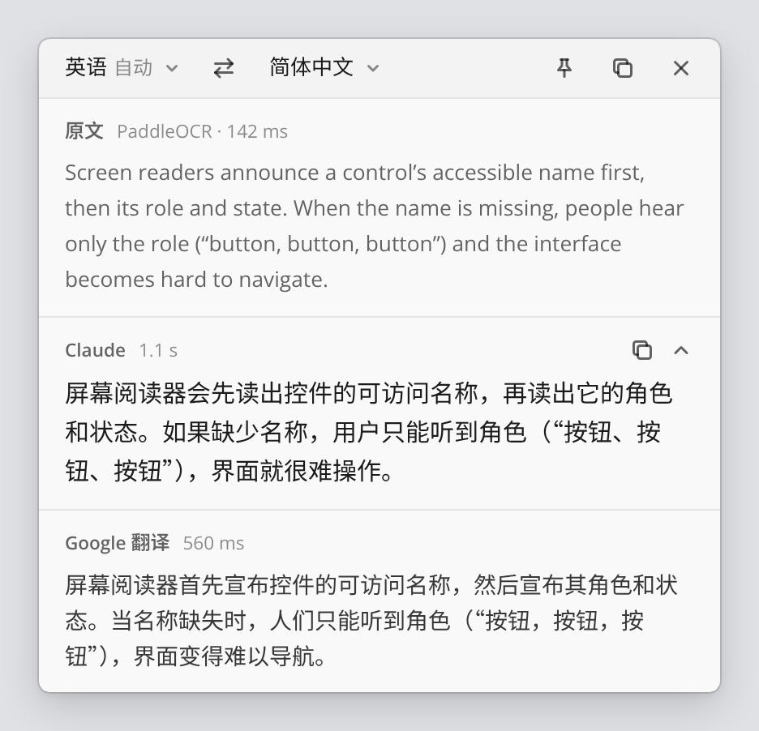
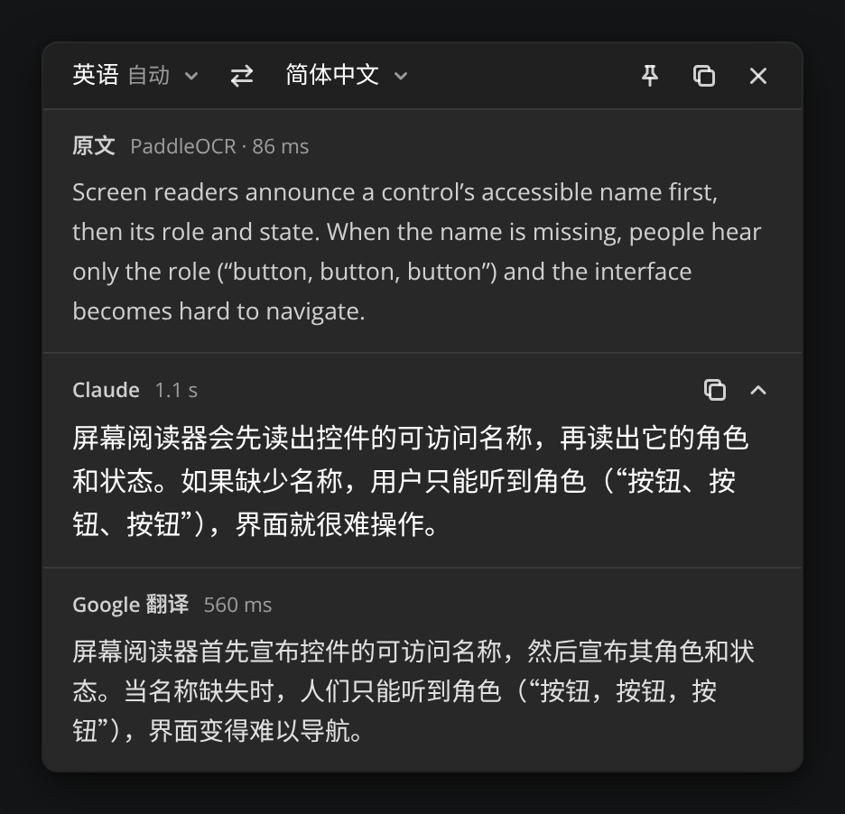

<p>
  
</p>

# Glint

A lightweight screenshot translation tool for Windows. Press a hotkey and the screen freezes. Drag a region, or click a window, and a small popup next to it shows the recognized text and its translation.

<p>
  
  
</p>

## Features

- **Instant capture**
  - A native Win32 + Direct2D overlay freezes the screen at the moment you press the hotkey.
  - Hovering over a window snaps the selection to it automatically.
  - A magnifier with a pixel grid and color readout follows the cursor.
  - Works across multiple monitors with different DPI scaling.
- **Offline OCR**
  - PP-OCRv6 (det + rec, about 30 MB) runs locally and recognizes Chinese, English, Japanese and 47 more languages.
  - Small text is upscaled automatically before recognition.
  - Line breaks are merged into paragraphs, and end-of-line hyphenation is undone.
  - If PaddleOCR cannot be loaded, Glint falls back to the built-in Windows OCR.
- **Multiple translation engines in parallel**
  - Claude, any OpenAI-compatible API (DeepSeek, Ollama and so on), Google, Bing, DeepL, Youdao and Baidu.
  - Results stream in as they arrive, and you can retry a single engine.
  - The LLM prompt is tuned for OCR input: it fixes obvious recognition errors, keeps the layout, and treats screen text as data rather than instructions.
- **Low footprint**
  - About 40 MB of memory when idle.
  - The popup's webview is created on demand and destroyed after 10 idle minutes.
  - The OCR model unloads after 15 idle minutes.

## Hotkeys

| Default | Action |
|---|---|
| `Alt+Q` | Capture and translate |
| `Alt+W` | Capture and recognize text (no translation) |
| `Alt+Shift+W` | Silent recognition: the text goes straight to the clipboard |

In the capture overlay:
- Drag to select, or click to pick the highlighted window.
- `Enter` confirms the highlighted window.
- `Ctrl+C` copies the recognized text only.
- Arrow keys move the cursor by one pixel.
- `Esc` or right-click cancels.

In the popup:
- `Ctrl+Enter` re-translates the edited source text.
- `Ctrl+P` pins the popup.
- `Esc` closes it.

All hotkeys can be changed in Settings, which also detects conflicts with other apps.

## Installation

Download the installer (`Glint_x.y.z_x64-setup.exe`) or the portable zip from Releases or the GitHub Actions build artifacts.

- Requires Windows 10 or 11, x64, with the WebView2 runtime (preinstalled on Windows 11).
- Google and Bing translation work out of the box.
- To use the other engines, enter your API key under Settings → Translation, then click **Test** to verify it.

## Development

See [docs/BUILD.md](docs/BUILD.md). Architecture and design notes:

| Document | Contents |
|---|---|
| [docs/ARCHITECTURE.md](docs/ARCHITECTURE.md) | Module boundaries, IPC contract, memory budget |
| [docs/DESIGN.md](docs/DESIGN.md) | Design language, tokens, component specs |
| [docs/RESEARCH.md](docs/RESEARCH.md) | Research on similar tools and the reasoning behind technical choices |

```
crates/glint-overlay    Screen capture and the native selection overlay (Win32 + Direct2D)
crates/glint-ocr        PP-OCRv6 (ONNX Runtime) + Windows.Media.Ocr, pre- and post-processing
crates/glint-translate  Translation engines, streaming, caching
src-tauri               App shell: tray, hotkeys, config, sessions, windows
ui                      Svelte 5 popup and settings pages
```
